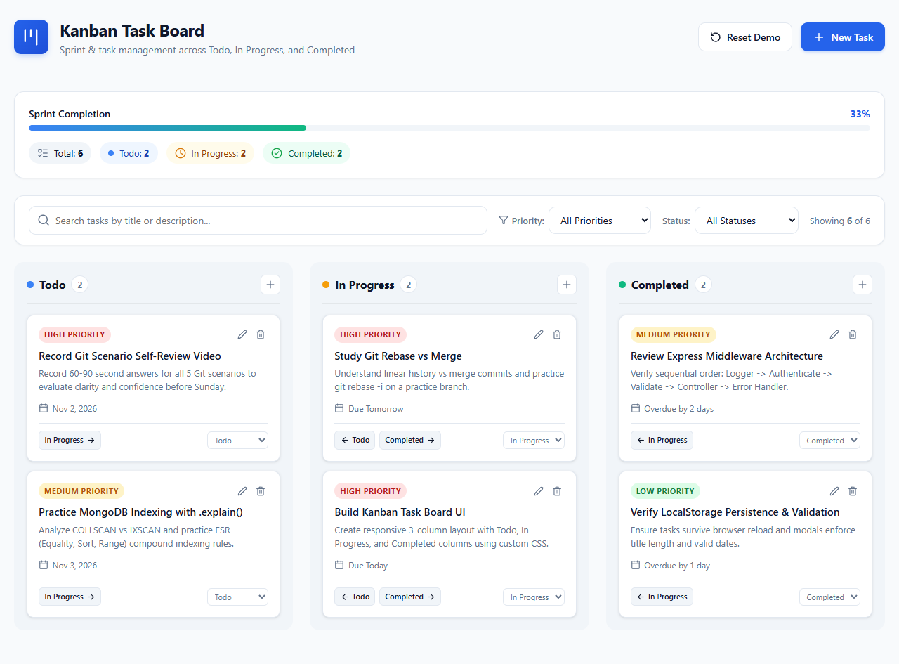
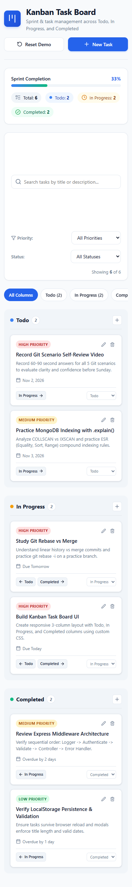

# Kanban Task Board — Machine Coding Project

A responsive, feature-rich **Kanban Task Board** built with modern React (Vite), HTML5 Drag-and-Drop, search & priority filters, and LocalStorage persistence.

Designed with a well-structured, categorized folder architecture, custom React hooks, clean separation of concerns, and human-learner code clarity.

---

## 📸 Application Previews

| Desktop View (3-Column Kanban Grid) | Mobile View (Adaptive Navigation Tabs) |
| :---: | :---: |
|  |  |

---

## 📁 Categorized Project Folder Structure

```
kanban-task-board/
├── docs/
│   └── screenshots/
│       ├── desktop_view.png          # High-resolution desktop screenshot
│       └── mobile_view.png           # Mobile responsive layout screenshot
│
├── tests/
│   ├── test_logic.js                 # 23-test headless logic and state test suite
│   └── browser_test.js               # Real browser integration & screenshot test
│
├── public/
│   └── favicon.svg                   # Kanban SVG favicon
│
├── src/
│   ├── components/                   # Categorized UI Components
│   │   ├── common/                   # Shared UI building blocks
│   │   │   ├── EmptyState.jsx        # Empty column & zero-search UX states
│   │   │   └── PriorityBadge.jsx     # High / Medium / Low colored badge
│   │   │
│   │   ├── kanban/                   # Core Kanban Domain Components
│   │   │   ├── KanbanBoard.jsx       # 3-column grid & mobile tabs layout
│   │   │   ├── KanbanColumn.jsx      # Column container, drop target & count badge
│   │   │   └── TaskCard.jsx          # Draggable card with quick-move buttons
│   │   │
│   │   ├── layout/                   # Global Page Layout Components
│   │   │   ├── Header.jsx            # App header, title, and "New Task" button
│   │   │   ├── MetricsBar.jsx        # Sprint completion progress bar & badges
│   │   │   └── FilterBar.jsx         # Live search box, priority & status selects
│   │   │
│   │   └── modals/                   # Accessible Dialog Modals
│   │       ├── TaskModal.jsx         # Add/Edit task modal with real-time validation
│   │       └── DeleteConfirmModal.jsx# Safe deletion confirmation dialog
│   │
│   ├── constants/                    # Application Configuration
│   │   └── kanbanConstants.js        # Column definitions, priorities, limits
│   │
│   ├── hooks/                        # Custom React Hooks (Business Logic)
│   │   ├── useTasks.js               # Task state, CRUD, metrics & LocalStorage sync
│   │   └── useKanbanFilters.js       # Live search & multi-parameter filtering
│   │
│   ├── utils/                        # Pure Helper Functions
│   │   ├── dateHelpers.js            # Due date formatting & overdue calculations
│   │   └── storage.js                # Safe LocalStorage serialization & error handling
│   │
│   ├── data/
│   │   └── initialTasks.js           # Starter sprint dataset
│   │
│   ├── App.jsx                       # Main orchestrator component
│   ├── index.css                     # Responsive CSS design tokens & animations
│   └── main.jsx                      # React 19 entry point
│
├── index.html                        # HTML5 document entry
├── vite.config.js                    # Vite bundler configuration
├── package.json                      # NPM dependencies and scripts
├── LICENSE                           # MIT License
└── README.md                         # Project documentation
```

---

## 🚀 Live Features & User Experience

### 1. 3-Column Task Progression
* **Todo:** Tasks waiting to be picked up.
* **In Progress:** Active work items currently being executed.
* **Completed:** Finished tasks.

### 2. Dual Status Movement (Desktop & Mobile Friendly)
* **HTML5 Drag and Drop:** Drag any task card and drop it onto any column. Columns dynamically highlight (`column-drag-over`) as active drop targets.
* **Quick-Move Controls:** Every card has directional arrows (`←` / `→`) and a status dropdown. This ensures touch users on mobile and keyboard navigation users can move tasks effortlessly without relying on drag-and-drop.

### 3. Add & Edit Modal with Real-Time Validation
* Fields:
  * **Title:** Required, 2–80 characters.
  * **Status:** Todo, In Progress, Completed.
  * **Priority:** High, Medium, Low.
  * **Due Date:** Date selector with automatic relative labels (`Due Today`, `Due Tomorrow`, etc.).
  * **Description:** Optional multi-line notes (up to 500 characters).
* Inline validation with clear error messages.
* Accessible: Autofocuses title input upon opening, and closes on `Esc` key or backdrop click.

### 4. Delete Confirmation Dialog
* Deleting triggers a confirmation modal displaying the specific task title to prevent accidental data loss.

### 5. Multi-Parameter Search & Filtering
* **Live Keyword Search:** Instant search matching task title or description with a quick-clear (`X`) button.
* **Priority Filter:** Filter by High, Medium, or Low priority.
* **Column / Status Filter:** View tasks from specific columns or all columns simultaneously.
* **Active Filter Summary:** Shows matching count (e.g. `Showing 4 of 6`) and a "Clear Filters" button.

### 6. Overdue Due Date Alerts
* If a task has a due date in the past and is not yet in the `Completed` column, it automatically displays an **Overdue** alert badge with red indicator styling and increments the top sprint alert counter.

### 7. Sprint Metrics Dashboard
* Dynamic progress bar showing sprint completion percentage (`completedCount / totalCount * 100`).
* Real-time badges for Total, Todo, In Progress, Completed, and Overdue tasks.

### 8. Persistence via LocalStorage
* All task operations (create, edit, delete, status move) synchronize automatically with browser LocalStorage.
* Safe JSON wrapper prevents crashes in private browsing mode or storage quota limits.
* Includes a "Reset Demo Data" button to easily restore starter tasks.

### 9. Fully Responsive Layout
* **Desktop ($> 840px$):** 3-column side-by-side grid.
* **Mobile / Tablet ($\le 840px$):** Adaptive column switcher tabs (`All Columns`, `Todo (3)`, `In Progress (2)`, `Completed (1)`) preventing horizontal scrolling.

---

## 🧠 Key Architecture & Clean Code Decisions

1. **Separation of Concerns via Custom Hooks (`useTasks`, `useKanbanFilters`):**
   * Keeping business logic and state transitions out of the main `App.jsx` makes components simple, pure, and easy to maintain.
2. **Categorized Component Structure (`components/layout/`, `kanban/`, `modals/`, `common/`):**
   * Organizing components by domain responsibility rather than having a messy flat directory.
3. **Centralized Configuration (`constants/kanbanConstants.js`):**
   * Columns, priorities, and validation bounds live in one single source of truth.
4. **`useMemo` for Derived Filtering & Metrics:**
   * Prevents unnecessary recalculations on unrelated component renders.
5. **Optimistic LocalStorage Sync:**
   * Centralizes storage writes into a single clean effect rather than scattering `localStorage.setItem` inside every handler.

---

## 🛠️ Local Development & Build

```bash
# 1. Install dependencies
npm install

# 2. Start local dev server (http://localhost:5173)
npm run dev

# 3. Build optimized production bundle
npm run build

# 4. Preview production build locally
npm run preview
```

---

## 🧪 Automated Testing

### 1. Headless Logic & State Verification Suite (23 Tests)
```bash
npm test
```
*Verifies: Initial schema, input validation, CRUD operations, state transitions, search and priority filtering, and overdue date calculations.*

### 2. Real Browser Integration & Screenshot Test
```bash
npm run test:browser
```
*Launches headless Chrome/Edge, verifies column and card rendering, interacts with search, and takes high-resolution desktop and mobile screenshots.*

---

## 🌐 Production Deployment Guide

### Deploying to Vercel:
1. Push this repository to GitHub.
2. Go to [vercel.com](https://vercel.com) and click **Add New Project**.
3. Import the repository.
4. Framework Preset: **Vite**.
5. Click **Deploy**. Vercel will build and serve your app at a live `.vercel.app` URL.

### Deploying to GitHub Pages:
1. In `vite.config.js`, set `base: './'`.
2. Run `npm run build`.
3. Deploy the generated `dist` folder to GitHub Pages via `gh-pages` or the GitHub Actions static pages workflow.
